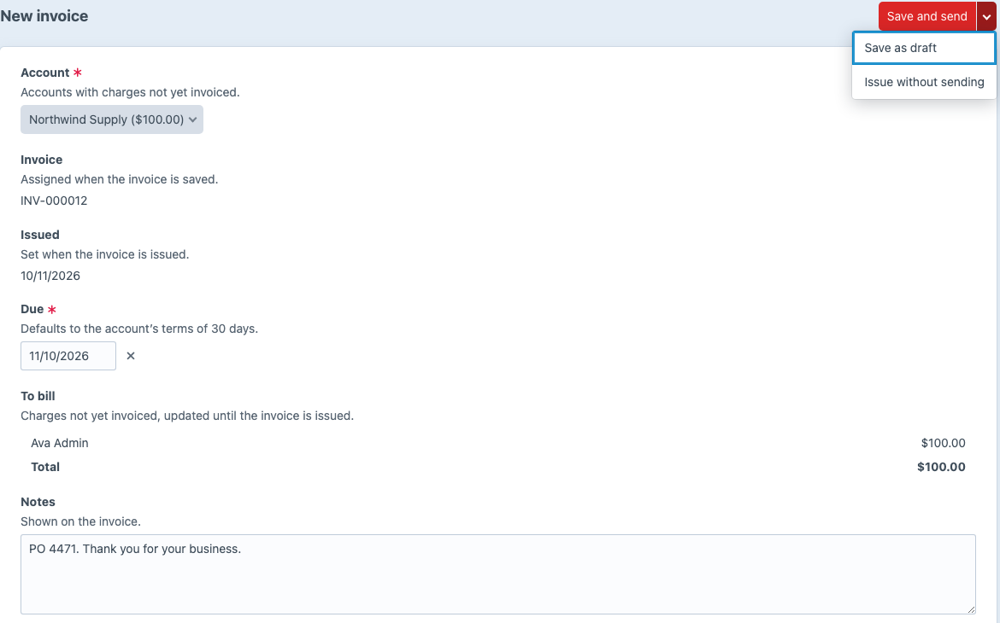
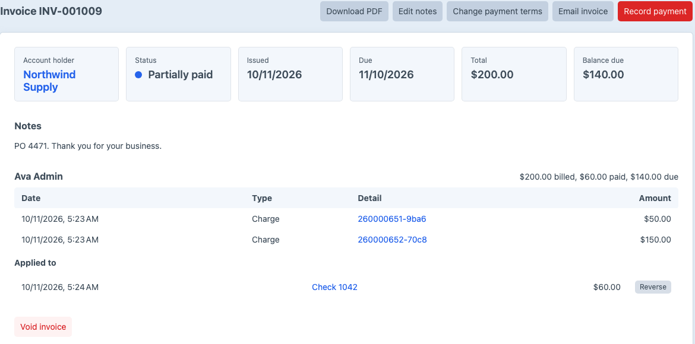
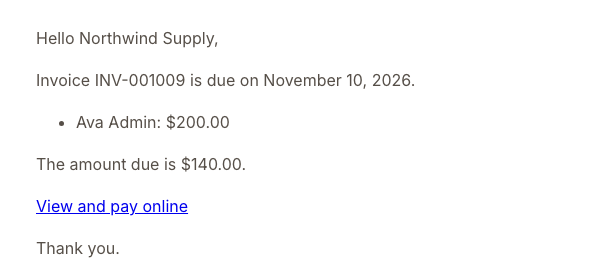

# Invoices

How an account's balance is billed, and what happens to an invoice as it is paid.

Invoices are issued only in invoice billing. In [order billing](./order-billing.md), the orders are the bills.

## Creating an invoice

Creating, issuing, emailing and voiding invoices, and changing their payment terms and notes, needs the **Manage invoices and payments** permission.

Click **New invoice** in **Net Terms -> Invoices** and choose the account, or click it on an account's **Invoices** tab, where the account is already chosen. The account list shows only accounts with charges not yet invoiced. The page shows the invoice number, the issue date, and what the invoice will bill to each buyer.

| Field | Description |
|---|---|
| Due | The date the invoice is due. Defaults to today plus the account's [payment terms](./accounts-and-buyers.md#payment-terms), and can't be before today. |
| Notes | Text shown on the invoice's page and its PDF. Emails show it where their body uses `{{ notes }}`. |

Then save the invoice:

| Button | What it does |
|---|---|
| Save and send | Issues the invoice and sends the invoice email. |
| Save as draft | Saves a [draft](#drafts) to issue later. |
| Issue without sending | Issues the invoice without emailing it. Send it later with **Email invoice**. |

**Save as draft** and **Issue without sending** are in the menu next to **Save and send**. When the invoice email is turned off, the buttons are **Issue invoice** and **Save as draft**.

To issue invoices on a schedule, run the [console command](../reference/console-commands.md) from cron.

An invoice bills every charge, refund, adjustment and order change not yet invoiced, with one line per buyer. Account adjustments made without a buyer get a line of their own. A buyer whose uninvoiced entries add up to zero or less gets no line, and those entries go on the next invoice. When no buyer's uninvoiced entries add up to more than zero, Net Terms doesn't issue an invoice.

Invoices are numbered from the **First invoice number** setting, padded to at least six digits, after the **Invoice number prefix**. With the defaults, invoices are numbered `INV-000001`, `INV-000002` and so on. See [configuration](../reference/configuration.md). Net Terms numbers an invoice when it is first saved, as an invoice or as a draft.

An invoice issued from a draft is due on the draft's due date. An invoice issued by the console command is due its account's payment terms after its issue date.

## Drafts

A draft has an invoice number, a due date and notes. It doesn't bill charges until it is issued. Net Terms works out its lines at issue, including charges made after the draft was saved.

- An account has one draft at a time. **New invoice** on that account opens its draft.
- `craft.netTerms` doesn't return drafts, and Net Terms doesn't send reminders for them.
- The console command skips an account with a draft.
- To delete a draft, choose **Delete draft** from the menu next to **Save and send** (or **Issue invoice**). Its number isn't used again.

## Changing an invoice's notes

To change an issued invoice's notes, click **Edit notes** on its page, and click **Save notes**. The invoice's page, its PDF, and emails sent from then on show the new notes.

## Changing an invoice's payment terms

To change when one invoice is due, click **Change payment terms** on its page, enter the **Payment terms** in days from the issue date, and click **Save terms**. Net Terms moves the due date to the issue date plus those days. The account's terms and its other invoices don't change. A voided invoice's terms can't change.

For how the new due date affects reminders, see [reminders](./reminders.md#when-a-due-date-changes).

## Statuses

| Status | Meaning |
|---|---|
| Draft | Saved, not yet issued. |
| Open | No payment has been applied. |
| Partially paid | Some of the balance has been paid. |
| Paid | The balance is zero. |
| Voided | The invoice was voided, and its entries go on the next invoice. |

An invoice past its due date with a balance shows as **Overdue**. To email the account holder before and after an invoice's due date, see [reminders](./reminders.md).

## The invoice email

**Email invoice** sends the invoice with the invoice email in **Net Terms -> Emails**. Edit its recipients, subject, body and PDF there; see [invoice billing emails](./reminders.md#invoice-billing-emails). When the email is turned off, **Email invoice** doesn't send an email.

## The invoice PDF

Each invoice has one PDF, named after its number, such as `INV-001009.pdf`. Set it up in **Net Terms -> Settings**, under **Invoice PDF**:

| Setting | What it does |
|---|---|
| Template | A site template that renders the PDF. Leave blank to use the plugin's plain invoice. To brand it, copy `vendor/fostercommerce/commerce-net-terms/src/templates/_pdfs/invoice.twig` into your templates and set its path here. |
| Paper size, Orientation | The page. |

The template receives `invoice`, `account`, `figures` (`total`, `paid`, `balance`, `status`), `lines`, `figuresByLineId`, `entriesByLineId`, `ordersById` and `invoiceUrl`.

An email attaches the PDF when its **Attach the invoice PDF** switch is on; the invoice email starts with it on. An invoice's page in the control panel has **Download PDF**, and storefront templates can link to the PDF with `craft.netTerms.getInvoicePdfUrl(invoice)`; see [storefront templates](../dev-guide/storefront-templates.md).

## Voiding an invoice

To void an invoice, click **Void invoice** on its page. Net Terms doesn't void an invoice while payments are applied to it; reverse them first. A voided invoice keeps its number, and its charges go on the next invoice.
